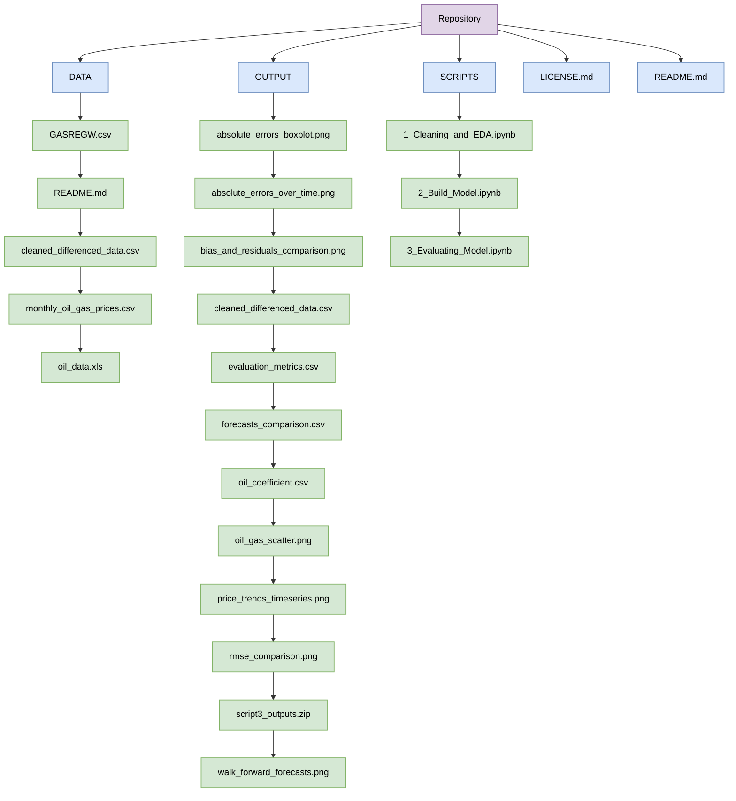

# DS4002_Project_2
## Table of Contents
1. Software and Platform  
2. Documentation Map  
3. Instructions for Reproduction  

## Software and Platform
Softwares used: Google Colab and Python 3.10.12  
Add-ons: pandas 2.2.2, numpy 1.26.4, matplotlib 3.7.1, seaborn 0.13.1, statsmodels 0.14.2, scikit-learn 1.5.2  
Platform: Windows  

## Documentation Map

## Instructions for Reproduction
1. Download gasoline price data from FRED (`GASREGW.csv`) and crude oil price data from EIA (`oil_data.xls`). Save both files in the DATA folder. *Note: Steps 2–5 can be accomplished by running `1_Cleaning_and_EDA.ipynb` in Google Colab.*
2. Import the required libraries and load both datasets into pandas DataFrames.
3. Clean the datasets by converting dates and prices into appropriate formats and removing observations with missing or invalid values.
4. Convert both datasets into monthly averages, merge them by date, and apply logarithmic transformations to gasoline and crude oil prices.
5. Perform exploratory data analysis, including price trends and correlation. Export the processed dataset as `monthly_oil_gas_prices.csv`. *Note: Steps 6–11 can be accomplished by running `2_Build_Model.ipynb` in Google Colab.*
6. Import the processed dataset, shift logged crude oil prices back one month (t-1), and perform ADF and KPSS tests to check stationarity.
7. Calculate first differences of logged prices and fit initial SARIMA and SARIMAX models to the differenced data.
8. Split the logged price data chronologically into training (before 2020) and testing (2020 onward) datasets without shuffling.
9. Build and fit SARIMA and SARIMAX forecasting models with order (1,1,1) and seasonal order (1,1,1,12). SARIMA uses historical gasoline prices, while SARIMAX includes lagged crude oil prices.
10. Perform one-month-ahead walk-forward validation by repeatedly forecasting with updated historical observations without refitting. Include a naive forecast using the previous month's gasoline price.
11. Convert predictions back to dollars per gallon and export `forecasts_comparison.csv`, `evaluation_metrics.csv`, and `oil_coefficient.csv` to OUTPUT. Export `cleaned_differenced_data.csv` to DATA. *Note: Steps 12–15 can be accomplished by running `3_Evaluating_Model.ipynb` in Google Colab.*
12. Import actual gasoline prices and forecast results from the naive, SARIMA, and SARIMAX models.
13. Calculate RMSE, MAE, and MAPE to compare forecasting accuracy across all three models.
14. Examine the crude oil coefficient and its p-value from the initial SARIMAX model to assess statistical significance.
15. Plot actual versus predicted gasoline prices and compare model performance using forecast errors, RMSE, and residual visualizations. Determine whether SARIMAX improves forecasting accuracy compared with SARIMA.

## References
[1] Federal Reserve Bank of St. Louis, "U.S. Regular All Formulations Retail Gasoline Prices (GASREGW)," FRED. Available: https://fred.stlouisfed.org/series/GASREGW  
[2] U.S. Energy Information Administration, "Cushing, OK WTI Spot Price FOB (RWTCD)." Available: https://www.eia.gov/dnav/pet/hist/RWTCD.htm  
[3] S. P. A. Brown and M. K. Yücel, "Gasoline and crude oil prices: Why the asymmetry?," Economic and Financial Review, Federal Reserve Bank of Dallas, pp. 23–29, 2000.  
[4] R. J. Hyndman and G. Athanasopoulos, Forecasting: Principles and Practice, 3rd ed., OTexts, 2021. https://otexts.com/fpp3/  
