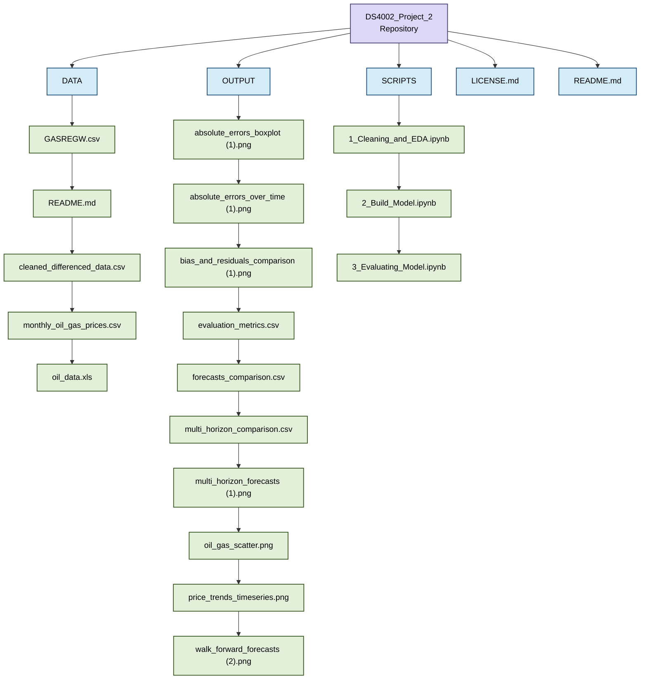

# DS4002_Project_2
## Table of Contents
1. Software and Platform  
2. Documentation Map  
3. Instructions for Reproduction  

## Software and Platform
Softwares used: Google Collab and Python 3.13.15    
Add-ons: pandas 2.2.3, numpy 2.1.3, matplotlib.pyplot 3.10.0, seaborn 0.13.2, scikit-learn 1.6.1, joblib 1.6.0    
Platform: Windows

## Documentation Map

## Instructions for Reproduction
1. Download gasoline price data from FRED and crude oil price data from EIA. Save both as CSV files in the DATA folder.
Note: Steps 2–6 can be accomplished by running 1_Data_Cleaning_EDA.ipynb.
2. Import required libraries and load both datasets into pandas DataFrames.
3. Clean missing values by removing empty observations and interpolating remaining missing values.
4. Convert both datasets into monthly averages and merge them by date.
5. Apply a log transformation to the price variables and shift crude oil prices back one month (t-1) to use as a predictor.
6. Perform exploratory data analysis, including price trends and correlation. Export the cleaned dataset as cleaned_gas_oil_data.csv.
*Note: Steps 7–13 can be accomplished by running 2_SARIMA_SARIMAX_Modeling.ipynb.
7. Import the cleaned dataset and perform ADF and KPSS tests to check stationarity.
8. Split the data chronologically into training (before 2020) and testing (2020 onward) datasets without shuffling.
9. Build and fit a SARIMA model using historical gasoline prices only.
10. Build and fit a SARIMAX model using historical gasoline prices and lagged crude oil prices as an additional variable.
11. Generate forecasts for 1-month, 3-month, 6-month, and 12-month horizons.
12. Perform walk-forward validation by repeatedly forecasting using updated historical data.
13. Convert predictions back to dollars per gallon and export the forecast results.
*Note: Steps 14–17 can be accomplished by running 3_Model_Evaluation.ipynb.
14. Import actual gasoline prices and forecast results from both models.
15. Calculate RMSE, MAE, and MAPE to compare forecasting accuracy.
16. Perform a Diebold-Mariano test to determine whether the difference in forecast accuracy is statistically significant (p < 0.05).
17. Plot actual vs. predicted gasoline prices and compare model performance. Determine whether SARIMAX improves forecasting accuracy based on lower RMSE and a statistically significant difference.

## References
[1] Federal Reserve Bank of St. Louis, "U.S. Regular All Formulations Retail Gasoline Prices (GASREGW)," FRED. Available: https://fred.stlouisfed.org/series/GASREGW  
[2] U.S. Energy Information Administration, "Cushing, OK WTI Spot Price FOB (RWTCD)." Available: https://www.eia.gov/dnav/pet/hist/RWTCD.htm  
[3] S. P. A. Brown and M. K. Yücel, "Gasoline and crude oil prices: Why the asymmetry?," Economic and Financial Review, Federal Reserve Bank of Dallas, pp. 23–29, 2000.  
[4] R. J. Hyndman and G. Athanasopoulos, Forecasting: Principles and Practice, 3rd ed., OTexts, 2021. https://otexts.com/fpp3/  
